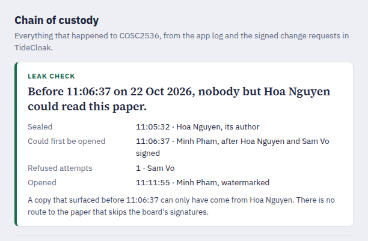

[](https://tide.org/tidecloak?utm_source=github&utm_medium=readme&utm_campaign=unlocked)

## Project overview

_Exam Vault removes unilateral release authority from exams: boards can distribute papers early to every centre, and nobody, not even IT, can open one before the board signs its release._

Built with [TideCloak](https://tide.org/tidecloak?utm_source=github&utm_medium=readme&utm_campaign=unlocked).

### 1. Vision & originality
A new operating model for high-stakes release, not a safer file vault. Exam release becomes a policy problem instead of a custody problem: papers go out the night before to every centre, and no centre, administrator or server can read them early. Workflow tools track approvals, but an operator can still override them. Here nobody can.

### 2. Trust constraint insight
The problem is not storage; it is unilateral authority. Exam release fails whenever one person or system can act alone. NEET-UG 2024 ran at 4,750 centres, and its paper was taken from a trunk at one. In software, that person is whoever runs the server.

### 3. Value & impact
Before: printed early, couriered, guarded. After: uploaded encrypted the night before, opened at 9:00 by quorum.
- **Boards:** no custody chain to coordinate.
- **Centres:** no couriers or strong rooms.
- **Candidates:** fewer cancellations. UGC-NET 2024 was cancelled for 900,000 people over a screenshot later found doctored.
- **Auditors:** a signed record per sitting.

### 4. Why TideCloak matters
TideCloak makes release authority emerge only when 2 of 3 board members sign. The app server never holds a reusable opening key and cannot grant itself one.

### 5. Prototype & storytelling
**Key moment:** Sam, the IT administrator, clicks Open and all 20 Tide nodes refuse; Sam's self-grant stalls. The [2-minute demo](demo/exam-vault-demo.mp4) runs the live app: Hoa seals a paper, Sam is refused, two board members release it to Minh, Minh opens a watermarked copy, and the leak check shows only Hoa could read it earlier.




## How it works: TideCloak vs the app

| | TideCloak enforces | Exam Vault (the app) does |
|---|---|---|
| **Sealing** | Encrypts the paper through the Tide network under a policy bound to one exam. No key is ever stored by the app. | Gives the examiner a sheet to write on and stores the ciphertext. |
| **Release** | The opening role (`_tide_decryptor`) can only be granted by a change request that 2 of 3 board members sign in their own Tide enclaves. The app server cannot manufacture it. | Shows who holds the key, collects requests, and lets each board member approve or deny. |
| **Opening** | The Tide nodes decrypt only when identity, role and policy line up. The authority emerges at that moment; nobody holds it in advance. | Shows the paper with a watermark naming the holder and the time. |
| **Proof** | Every grant carries board signatures with timestamps. | Turns them into the chain of custody and the leak check. |

What a breach gets: the server holds ciphertext and signed policies, no key and no plaintext. An administrator who controls the server and the identity system is refused by the network like anyone else, and their own request for the key stalls at 1 of 2 signatures.

## Setup

**Requirements:** Docker, Node.js 20+, `bash`, `curl`, `jq`, Chrome or Chromium.

1. **Start TideCloak** (dev image):
   ```bash
   docker run -d --name mytidecloak -p 8080:8080 \
     -e KC_BOOTSTRAP_ADMIN_USERNAME=admin -e KC_BOOTSTRAP_ADMIN_PASSWORD=password \
     tideorg/tidecloak-dev:latest
   ```
2. **Install:** `npm install`
3. **Create the realm and the three demo people:**
   ```bash
   NEW_REALM_NAME=examvault CLIENT_NAME=examvault-app \
   SUBSCRIPTION_EMAIL=you@example.edu TIDE_TERMS_ACCEPTED=yes \
   REALM_JSON_PATH=$PWD/init/realm.json bash init/tcinit.sh
   ```
   - The script prints an enrollment link for `admin` (Sam Vo, IT Administrator). It writes links for `examoffice` (Hoa Nguyen, Head of Examinations) and `invigilator` (Minh Pham, Chief Invigilator) to `init/.invite-links.txt`.
   - Open each link in its own browser profile and create a Tide account. The script waits until all three are linked, switches the realm to multi-admin governance, and writes `tidecloak.json`. That file holds public adapter config only. It is overwritten for your own realm.
4. **Run:** `npm run build && npm start` (or `npm run dev`), then open http://localhost:3000.
5. **Seat the board:** sign in as Sam.
   - Click **Seat Hoa Nguyen** and **Seat Minh Pham**, then approve each in the Tide window.
   - Approve the **Update the board's signing rule** request. The quorum becomes 2 of 3.
6. **Prepare a sitting:** use **Open a sitting** in the sidebar, then click **Authorise sealing** and **Authorise opening**. Then follow the story in the demo, using one browser profile per person.

**Notes**
- **Plan limit:** the free Tide plan allows 3 Tide accounts per realm. That is why the demo has three people, and all three sit on the board.
- **Local network prompt:** Chrome may ask whether `ork1.tideprotocol.com` can reach `localhost`. Allow it, or sign-in and approvals time out.
- **Data:** papers, signed policies and the app log live in `data/store.json`, which is gitignored. All people and papers are synthetic.
- **Limits:** once a paper is open, nothing stops a photo of the screen. The watermark names who opened it and when. Revoking the key stops future opening, not copies already made.

**What is in the app**
- **Sealed envelope.** The paper is shown as a sealed exam envelope. Its security tint is the real ciphertext.
- **Release panel.** Shows who may seal, who may open, and who holds the opening key right now. Each pending request has three signature seals that fill as board members sign.
- **Leak check.** Sits on top of the chain of custody. It states the minute before which nobody but the author could have read the paper, who signed the release, every refused attempt, and when the paper was opened. If a copy surfaces online earlier than that minute, it can only have come from the author.
- **Chain of custody.** A timeline per sitting. It merges the app's own log (sealed, opening refused, opened) with TideCloak's change requests: who asked, each signature with its time, the commit or the denial.
- **Server view.** Shows the full server record for the sitting: ciphertext and signed policies, no key and no plaintext.
- **Exam-room copy.** An opened paper carries a watermark with the holder's name and the time. **Present in exam room** shows it full screen.

**Implementation choices**
- **Approvals stay in the browser.** Change requests are approved from the board member's own browser, with their DPoP-bound token (`IAMService.secureFetch`). They never go through the app server, so every signature belongs to a real person (`lib/tide/governance.ts`).
- **Policy and encryption code.** `lib/tide/relationship.ts` comes from the Tide agent pack's `RelationshipAttestation:1` template.
- **Two policies per sitting.** Sealing is authorised for the `lecturer` role and opening for the `invigilator` role. Holding the role is not enough: the caller also needs `_tide_encryptor` or `_tide_decryptor`. The board grants `_tide_decryptor` for the sitting and revokes it afterwards.
- **Storage.** A JSON file instead of a database, because the server only ever holds ciphertext and signed policies.
