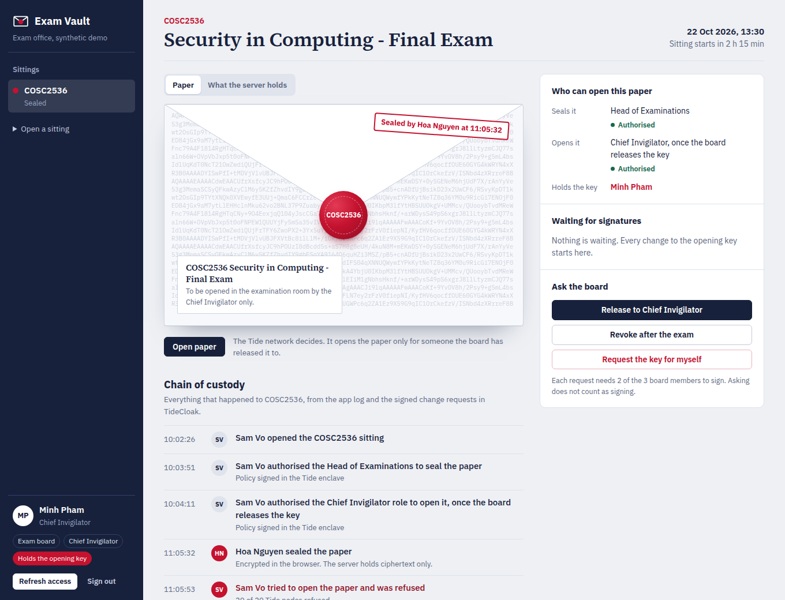
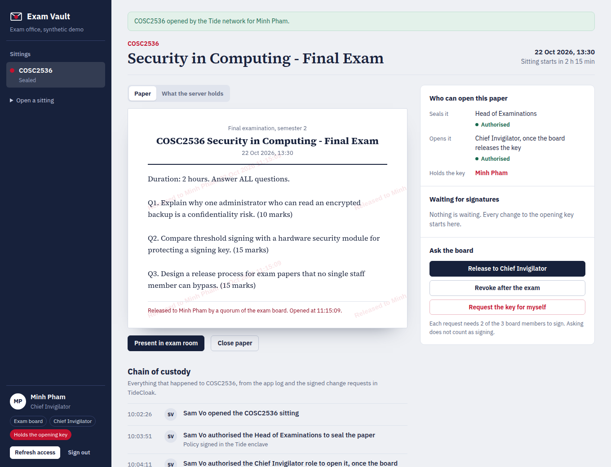

[](https://tide.org/tidecloak?utm_source=github&utm_medium=readme&utm_campaign=unlocked)

## Project overview

_Exam Vault seals exam papers so that no single person, not even the IT administrator, can open one until the exam board releases it._

Built with [TideCloak](https://tide.org/tidecloak?utm_source=github&utm_medium=readme&utm_campaign=unlocked).

### 1. Vision & originality
An exam office that never has to trust one person. The examiner seals the paper in the browser. On exam morning two of three board members sign its release in their own Tide enclaves. Only then can the Chief Invigilator open it.

### 2. Trust constraint insight
Whoever runs the server can read the paper: IT staff, backup operators, vendors, or anyone with one stolen admin password. A single leak forces a re-sit for hundreds of students, so papers still travel on USB sticks and in locked cabinets. Remove that insider and papers can live in software.

### 3. Value & impact
Exam officers stop couriering papers. Students stop paying for leaks with re-sits. IT staff stop being suspects. A phished administrator yields only ciphertext and a change request the board denies.

### 4. Why TideCloak matters
- The Tide network encrypts each paper under a policy bound to its exam. The app holds no key to steal.
- Release is TideCloak governance. The opening key is a change request that commits only when 2 of 3 board members sign, so an administrator's self-grant stops at 1 of 2.
- The server only ever stores ciphertext.

### 5. Prototype & storytelling
The [2-minute demo](demo/exam-vault-demo.mp4) runs on the live app:
1. Hoa seals the paper. The server holds only ciphertext.
2. Sam, the IT administrator, is refused by all 20 Tide nodes, and Sam's self-grant stalls.
3. Hoa denies it and requests release. Sam countersigns. The chain of custody records each signature.
4. Minh opens a watermarked copy in the exam room.





## Setup

**Requirements:** Docker, Node.js 20+, `bash`, `curl`, `jq`, Chrome or Chromium.

1. **Start TideCloak** (dev image):
   ```bash
   docker run -d --name mytidecloak -p 8080:8080 \
     -e KC_BOOTSTRAP_ADMIN_USERNAME=admin -e KC_BOOTSTRAP_ADMIN_PASSWORD=password \
     tideorg/tidecloak-dev:latest
   ```
2. **Install:** `npm install`
3. **Create the realm and the three demo people:**
   ```bash
   NEW_REALM_NAME=examvault CLIENT_NAME=examvault-app \
   SUBSCRIPTION_EMAIL=you@example.edu TIDE_TERMS_ACCEPTED=yes \
   REALM_JSON_PATH=$PWD/init/realm.json bash init/tcinit.sh
   ```
   - The script prints an enrollment link for `admin` (Sam Vo, IT Administrator). It writes links for `examoffice` (Hoa Nguyen, Head of Examinations) and `invigilator` (Minh Pham, Chief Invigilator) to `init/.invite-links.txt`.
   - Open each link in its own browser profile and create a Tide account. The script waits until all three are linked, switches the realm to multi-admin governance, and writes `tidecloak.json`. That file holds public adapter config only. It is overwritten for your own realm.
4. **Run:** `npm run build && npm start` (or `npm run dev`), then open http://localhost:3000.
5. **Seat the board:** sign in as Sam.
   - Click **Seat Hoa Nguyen** and **Seat Minh Pham**, then approve each in the Tide window.
   - Approve the **Update the board's signing rule** request. The quorum becomes 2 of 3.
6. **Prepare a sitting:** use **Open a sitting** in the sidebar, then click **Authorise sealing** and **Authorise opening**. Then follow the story in the demo, using one browser profile per person.

**Notes**
- **Plan limit:** the free Tide plan allows 3 Tide accounts per realm. That is why the demo has three people, and all three sit on the board.
- **Local network prompt:** Chrome may ask whether `ork1.tideprotocol.com` can reach `localhost`. Allow it, or sign-in and approvals time out.
- **Data:** papers, signed policies and the app log live in `data/store.json`, which is gitignored. All people and papers are synthetic.

**What is in the app**
- **Sealed envelope.** The paper is shown as a sealed exam envelope. Its security tint is the real ciphertext.
- **Release panel.** Shows who may seal, who may open, and who holds the opening key right now. Each pending request has three signature seals that fill as board members sign.
- **Chain of custody.** A timeline per sitting. It merges the app's own log (sealed, opening refused, opened) with TideCloak's change requests: who asked, each signature with its time, the commit or the denial.
- **Server view.** Shows the full server record for the sitting: ciphertext and signed policies, no key and no plaintext.
- **Exam-room copy.** An opened paper carries a watermark with the holder's name and the time. **Present in exam room** shows it full screen.

**Implementation choices**
- **Approvals stay in the browser.** Change requests are approved from the board member's own browser, with their DPoP-bound token (`IAMService.secureFetch`). They never go through the app server, so every signature belongs to a real person (`lib/tide/governance.ts`).
- **Policy and encryption code.** `lib/tide/relationship.ts` comes from the Tide agent pack's `RelationshipAttestation:1` template.
- **Two policies per sitting.** Sealing is authorised for the `lecturer` role and opening for the `invigilator` role. Holding the role is not enough: the caller also needs `_tide_encryptor` or `_tide_decryptor`. The board grants `_tide_decryptor` for the sitting and revokes it afterwards.
- **Storage.** A JSON file instead of a database, because the server only ever holds ciphertext and signed policies.
